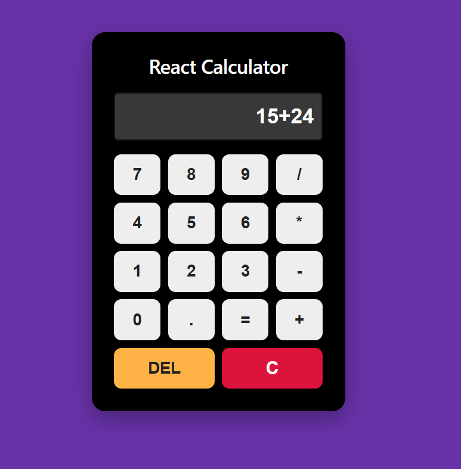
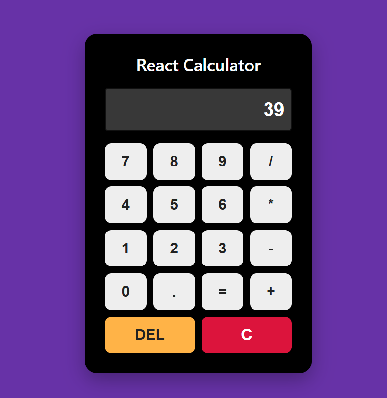

# Ex04 Simple Calculator - React Project
## Date:21.11.2026

## AIM
To  develop a Simple Calculator using React.js with clean and responsive design, ensuring a smooth user experience across different screen sizes.

## ALGORITHM
### STEP 1
Create a React App.

### STEP 2
Open a terminal and run:
  <ul><li>npx create-react-app simple-calculator</li>
  <li>cd simple-calculator</li>
  <li>npm start</li></ul>

### STEP 3
Inside the src/ folder, create a new file Calculator.js and define the basic structure.

### STEP 4
Plan the UI: Display screen, number buttons (0-9), operators (+, -, *, /), clear (C), and equal (=).

### STEP 5
Create a new file Calculator.css in src/ and add the styling.

### STEP 6
Open src/App.js and modify it.

### STEP 7
Start the development server.
  npm start

### STEP 8
Open http://localhost:3000/ in the browser.

### STEP 9
Test the calculator by entering numbers and operations.

### STEP 10
Fix styling issues and refine content placement.

### STEP 11
Deploy the website.

### STEP 12
Upload to GitHub Pages for free hosting.

## PROGRAM
**Calculator.jsx**
```

import React, { useState, useEffect } from "react";
import "./Calculator.css";

function Calculator() {
  const [display, setDisplay] = useState("");

  const handleClick = (value) => {
    setDisplay((prev) => prev + value);
  };

  const clearDisplay = () => {
    setDisplay("");
  };

  const backspace = () => {
    setDisplay((prev) => prev.slice(0, -1));
  };

  const calculate = () => {
    try {
      if (!display || !/^[0-9+\-*/.()\s]+$/.test(display)) {
        throw new Error("Invalid input");
      }

      const result = Function(
        '"use strict"; return (' + display + ')'
      )();

      if (!Number.isFinite(result)) {
        throw new Error("Invalid calculation");
      }

      setDisplay(String(result));
    } catch {
      setDisplay("Error");
    }
  };

  // Physical keyboard support
  useEffect(() => {
    const handleKeyDown = (event) => {
      const key = event.key;

      if (/^[0-9.]$/.test(key) || ["+", "-", "*", "/"].includes(key)) {
        handleClick(key);
      } else if (key === "Enter") {
        event.preventDefault();
        calculate();
      } else if (key === "Backspace") {
        backspace();
      } else if (key === "Escape") {
        clearDisplay();
      }
    };

    window.addEventListener("keydown", handleKeyDown);

    return () => {
      window.removeEventListener("keydown", handleKeyDown);
    };
  }, [display]);

  const buttons = [
    "7", "8", "9", "/",
    "4", "5", "6", "*",
    "1", "2", "3", "-",
    "0", ".", "=", "+",
  ];

  return (
    <div className="calculator">
      <h2>React Calculator</h2>

      <input
        type="text"
        value={display}
        readOnly
        className="display"
        placeholder="0"
      />

      <div className="buttons">
        {buttons.map((item) => (
          <button
            key={item}
            onClick={() =>
              item === "=" ? calculate() : handleClick(item)
            }
          >
            {item}
          </button>
        ))}

        <button className="delete" onClick={backspace}>
          DEL
        </button>

        <button className="clear" onClick={clearDisplay}>
          C
        </button>
      </div>
    </div>
  );
}

export default Calculator;
```

## OUTPUT




## RESULT
The program for developing a simple calculator in React.js is executed successfully.